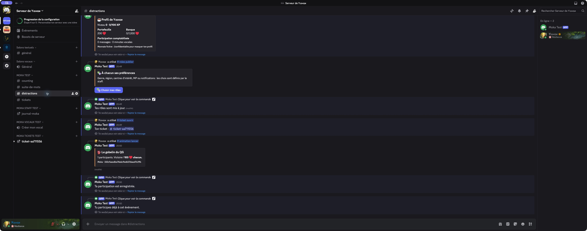
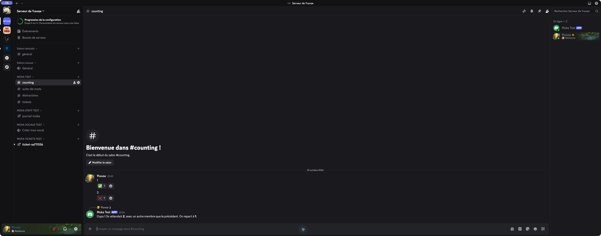

# Moka ☕

Un compagnon Discord francophone : discussions, progression et petites
animations pour faire vivre une communauté. Python 3.12+, SQLite, modules
activables séparément. Aucun service payant ni modèle IA requis.

**Version 0.1.0 : prototype avec une première démo réelle dans Discord et
61 tests locaux réussis.** Aide, récompense quotidienne, profil, rôle à choisir,
création de ticket, counting, suite de mots et gobelin après redémarrage ont été
essayés sur un serveur dédié. L'XP vocal à deux personnes et les autres parcours
restent à valider : [détail des vérifications](docs/VALIDATION.md).

Moka peut servir de base commune : code Python modifiable, licence MIT et
hébergement au choix de l'équipe. Chaque module peut être activé séparément,
notamment pour conserver les fonctions déjà assurées par un autre bot.

## Voir Moka dans Discord

Captures réelles du laboratoire personnel, le 25 octobre 2026. Elles montrent
le compte du testeur et le bot ; aucun échange de membres du serveur cible.
Cliquer sur une image permet de la lire en grand.



Le bouton du gobelin a survécu à un redémarrage. Une deuxième participation a
été refusée et une seule récompense de 100 cœurs a été versée.



Le rôle de pénalité a été attribué puis retiré à échéance. Le laboratoire utilise
un délai de 30 secondes ; la configuration par défaut prévoit trois heures.

Un [parcours de démonstration de cinq minutes](docs/DEMO.md) permet de présenter
le bot au staff. Une démonstration locale sans compte Discord est aussi disponible
ci-dessous.

## Ce qui est développé

| Module | Fonctions |
| --- | --- |
| Progression | XP écrit et vocal, niveaux, profils, classement, rôles de niveau |
| Économie | Cœurs fictifs, récompenses 24 h / 7 j, cadeaux, portefeuille |
| Banque | Dépôts, retraits, capacité, intérêts, amélioration de la protection |
| Distractions | Paris, jackpot collectif, vol de portefeuille, mini-jeu de hack |
| Gobelin | Groupe limité, compte à rebours, récompense collective, apparitions optionnelles |
| Jeux de salon | Counting, record, rôle d'erreur temporaire ; suite de mots avec deux modes |
| Ambiance | Compliments, taquineries légères, horoscope fictif |
| Boutique | Objets décoratifs en cœurs, inventaire et cadeaux ; aucune gemme |
| Communauté | Rôles à choisir, tickets privés, salons vocaux temporaires |
| Trombinoscope | Pré-accès, niveau minimum, approbation du staff, retrait d'accès après suppression |
| Administration | Configuration, diagnostic, correction journalisée des cœurs, timeout manuel |
| Données | Profil privé, export personnel, effacement confirmé, sauvegarde cohérente |

Le catalogue et les textes sont originaux. Les montants, probabilités et règles
par défaut sont des propositions, **pas une copie vérifiée de l'équilibrage de
Sylhbot**. Le vol bancaire, les immunités par rôle et les fonctionnalités de
modération non inventoriées ne sont pas implémentés à ce stade. La matrice
[fonction par fonction](docs/FONCTIONS.md) sépare le livré du reste à préciser.

## Essayer immédiatement, sans Discord

Avec [uv](https://docs.astral.sh/uv/getting-started/installation/) installé :

```sh
uv sync --locked --extra dev
uv run moka --config config.example.toml check
uv run moka demo
uv run pytest -q
```

`check` construit et sérialise réellement l'arbre des commandes Discord, sans
token ni requête réseau. `demo` joue un scénario dans une base SQLite jetable :
récompenses, banque, achat, cadeau, counting, gobelin et sauvegarde. Ce scénario
ne charge pas les membres du QG et ne crée aucun salon.

## Installer sur un serveur de test

Suivre [INSTALLATION.md](docs/INSTALLATION.md) : application Discord dédiée,
serveur de test explicitement autorisé, permissions limitées, configuration des
salons, puis synchronisation des commandes sur ce seul serveur.

Ne jamais copier le token dans le code, un ticket ou le README. `.env`, bases et
sauvegardes sont exclus de Git. Le bot refuse de démarrer sans token et sans
liste de serveurs autorisés.

## Organisation

```text
src/moka/
  base.py          Comptes, reçus, XP, transactions et configuration persistée
  economy.py       Banque, boutique, cadeaux, paris et vols
  games.py         Counting, mots, événements et règlements
  community.py     États persistants des tickets et des photos
  bot.py           Connexion, événements Discord et tâches de reprise
  discord_ui.py    Cartes et boutons persistants
  cogs/            Commandes membres, staff et communauté
tests/             Tests métier, concurrence et frontière Discord
```

- [Exploitation et sauvegardes](docs/EXPLOITATION.md)
- [État de validation et recette Discord](docs/VALIDATION.md)
- [Périmètre et inconnues](PLAN.md)
- [Sécurité](SECURITY.md)

## Indépendance de la communauté

Le code est distribué sous [licence MIT](LICENSE). Chaque équipe peut reprendre
le dépôt, modifier le bot et choisir son hébergement. Une équipe Discord peut
gérer l'application indépendamment du compte qui héberge ce dépôt. Les tokens
et données des membres restent privés : ils ne font pas partie de la diffusion
open source.

Une seule instance de Moka par base. SQLite suffit à cette première version ;
aucun dashboard web, port entrant, Redis ou PostgreSQL n'est nécessaire.

## Sources techniques

- [discord.py : installation et événements](https://discordpy.readthedocs.io/en/stable/intro.html)
- [discord.py : commandes et composants](https://discordpy.readthedocs.io/en/stable/interactions/api.html)
- [Discord : équipes de développement](https://docs.discord.com/developers/topics/teams)
- [uv dans Docker](https://docs.astral.sh/uv/guides/integration/docker/)

Les captures ci-dessus proviennent du vrai client Discord. Le scénario CLI est
une démonstration hors ligne séparée ; il ne prouve pas le fonctionnement de
tous les modules dans Discord.
