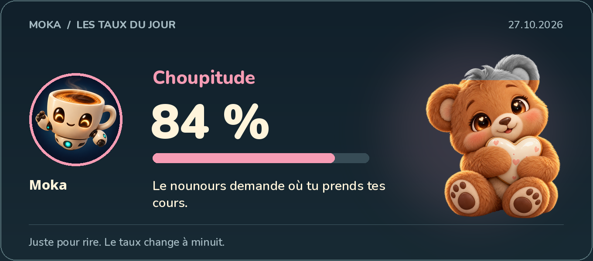
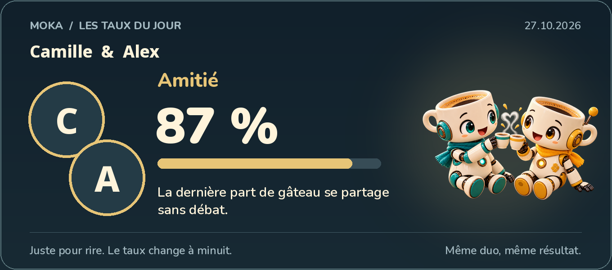

# Moka ☕

Un compagnon Discord francophone : discussions, progression et petites
animations pour faire vivre une communauté. Python 3.12+, SQLite, modules
activables séparément. Aucun service payant ni modèle IA requis.

**Version 0.2.0 : jeux de salon enrichis, cartes illustrées et 188 tests locaux
réussis.** Counting avec calculs et pile ou face, pause commune aux deux jeux,
déblocage par le staff, 14 taux et duos illustrés, 100 compliments et taquineries.
Plusieurs parcours ont été essayés dans un laboratoire Discord ; l'XP vocal à
deux personnes et la recette complète restent à valider :
[détail des vérifications](docs/VALIDATION.md).

Moka peut servir de base commune : code Python modifiable, licence MIT et
hébergement au choix de l'équipe. Chaque module peut être activé séparément,
notamment pour conserver les fonctions déjà assurées par un autre bot.

## Les cartes de Moka

Ces exemples sont générés par le véritable moteur de cartes, avec la mascotte
Moka et des noms fictifs. Les pourcentages sont illustratifs : ce sont des
aperçus, pas des captures du client Discord. Aucun avatar humain, identifiant
de membre ni conversation privée n'est inclus dans ces visuels.





`/taux type:choupitude` découvre ton taux du jour ; `/duo type:amitie
membre:@quelqu’un` mesure un duo pour rire. Huit types individuels et six duos,
fixes jusqu'à minuit à Paris, avec avatars et illustrations partiellement
colorées. Les pseudos grecs, cyrilliques et les emojis sont pris en charge.

Le counting accepte les calculs et tire à pile ou face après une erreur, avec
une amende configurable : [règles](docs/COUNTING.md). Le rôle **Pas-doué** impose
une pause d'une heure dans les deux jeux ; le staff la lève avec
`/debloquer membre` : [détails](docs/GAME-PENALTIES.md).

Un [parcours de démonstration de cinq minutes](docs/DEMO.md) permet de présenter
le bot au staff. Une démonstration locale sans compte Discord est aussi disponible
ci-dessous.

## Ce qui est développé

| Module | Fonctions |
| --- | --- |
| Progression | XP écrit et vocal, niveaux, profils, classement, rôles de niveau |
| Économie | Cœurs fictifs, récompenses 24 h / 7 j, cadeaux, portefeuille |
| Banque | Dépôts, retraits, capacité, intérêts, amélioration de la protection |
| Distractions | Paris, jackpot collectif, vol de portefeuille, mini-jeu de hack |
| Gobelin | Groupe limité, compte à rebours, récompense collective, apparitions optionnelles |
| Jeux de salon | Counting avec calculs, amende et pile ou face, record, rôle d'erreur temporaire ; suite de mots avec deux modes |
| Ambiance | 50 compliments et 50 taquineries bienveillantes, cinq dernières phrases évitées, horoscope fictif |
| Taux du jour | 8 taux individuels et 6 duos, cartes illustrées avec avatars, résultats fixes jusqu'à minuit |
| Boutique | Objets décoratifs en cœurs, inventaire et cadeaux ; aucune gemme |
| Communauté | Rôles à choisir, tickets privés, salons vocaux temporaires |
| Trombinoscope | Pré-accès, niveau minimum, approbation du staff, retrait d'accès après suppression |
| Administration | Configuration, diagnostic, correction journalisée des cœurs, timeout manuel |
| Données | Profil privé, export personnel, effacement confirmé, sauvegarde cohérente |

Le catalogue et les textes sont originaux. Les montants, probabilités et règles
par défaut sont des propositions, **pas une copie vérifiée de l'équilibrage de
Sylhbot**. Le vol bancaire, les immunités par rôle et les fonctionnalités de
modération non inventoriées ne sont pas implémentés à ce stade. La matrice
[fonction par fonction](docs/FONCTIONS.md) sépare le livré du reste à préciser.

## Essayer immédiatement, sans Discord

Avec [uv](https://docs.astral.sh/uv/getting-started/installation/) installé :

```sh
uv sync --locked --extra dev
uv run moka --config config.example.toml check
uv run moka demo
uv run pytest -q
```

`check` construit et sérialise réellement l'arbre des commandes Discord, sans
token ni requête réseau. `demo` joue un scénario dans une base SQLite jetable :
récompenses, banque, achat, cadeau, counting, gobelin et sauvegarde. Ce scénario
ne charge aucun membre Discord et ne crée aucun salon.

## Installer sur un serveur de test

Suivre [INSTALLATION.md](docs/INSTALLATION.md) : application Discord dédiée,
serveur de test explicitement autorisé, permissions limitées, configuration des
salons, puis synchronisation des commandes sur ce seul serveur.

Ne jamais copier le token dans le code, un ticket ou le README. `.env`, bases et
sauvegardes sont exclus de Git. Le bot refuse de démarrer sans token et sans
liste de serveurs autorisés.

## Organisation

```text
src/moka/
  base.py          Comptes, reçus, XP, transactions et configuration persistée
  economy.py       Banque, boutique, cadeaux, paris et vols
  games.py         Counting, mots, événements et règlements
  community.py     Tickets, photos et tirages des phrases d'ambiance
  social_catalog.py  50 compliments et 50 taquineries originales
  rates.py         Pourcentages quotidiens individuels et en duo
  rate_cards.py    Rendu local des cartes, avatars et emojis
  assets/          Illustrations et polices avec leurs licences
  bot.py           Connexion, événements Discord et tâches de reprise
  discord_ui.py    Cartes et boutons persistants
  cogs/            Commandes membres, staff et communauté
tests/             Tests métier, concurrence et frontière Discord
```

- [Exploitation et sauvegardes](docs/EXPLOITATION.md)
- [État de validation et recette Discord](docs/VALIDATION.md)
- [Taux du jour, duos et illustrations](docs/RATES.md)
- [Compliments et taquineries](docs/AMBIANCE.md)
- [Changements et mise à jour](CHANGELOG.md)
- [Crédits et licences des ressources](THIRD_PARTY_NOTICES.md)
- [Périmètre et inconnues](PLAN.md)
- [Sécurité](SECURITY.md)

## Indépendance de la communauté

Le code est distribué sous [licence MIT](LICENSE). Chaque équipe peut reprendre
le dépôt, modifier le bot et choisir son hébergement. Une équipe Discord peut
gérer l'application indépendamment du compte qui héberge ce dépôt. Les tokens
et données des membres restent privés : ils ne font pas partie de la diffusion
open source.

Une seule instance de Moka par base. SQLite suffit à cette première version ;
aucun dashboard web, port entrant, Redis ou PostgreSQL n'est nécessaire.

## Sources techniques

- [discord.py : installation et événements](https://discordpy.readthedocs.io/en/stable/intro.html)
- [discord.py : commandes et composants](https://discordpy.readthedocs.io/en/stable/interactions/api.html)
- [Discord : équipes de développement](https://docs.discord.com/developers/topics/teams)
- [uv dans Docker](https://docs.astral.sh/uv/guides/integration/docker/)

Les aperçus et la démonstration CLI sont produits hors ligne. Ils ne prouvent
pas le fonctionnement de tous les modules dans Discord. Les essais réels sont
décrits séparément dans [VALIDATION.md](docs/VALIDATION.md).
